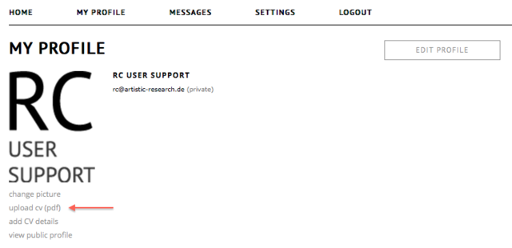
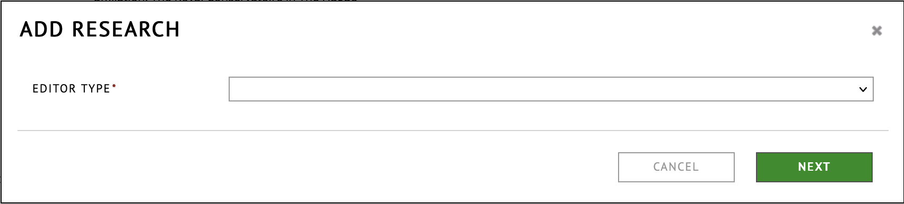
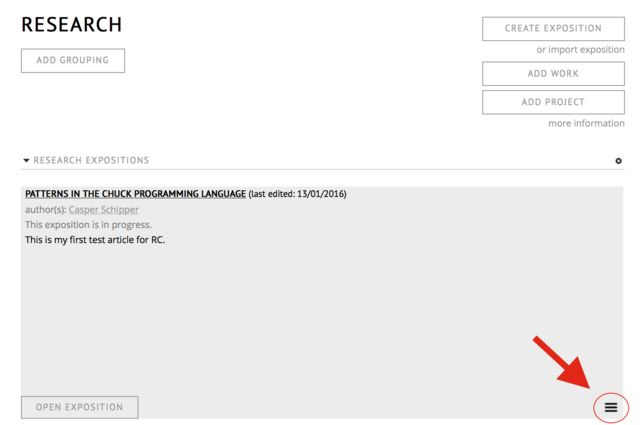
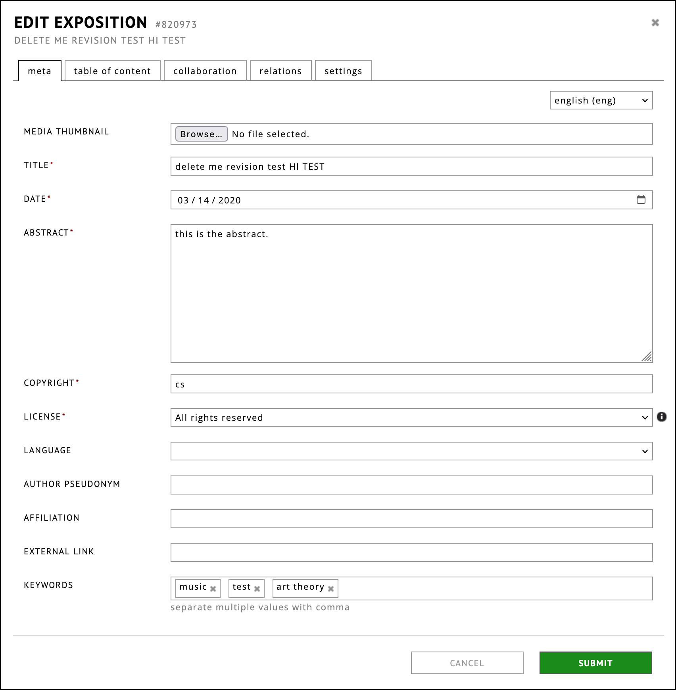
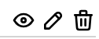
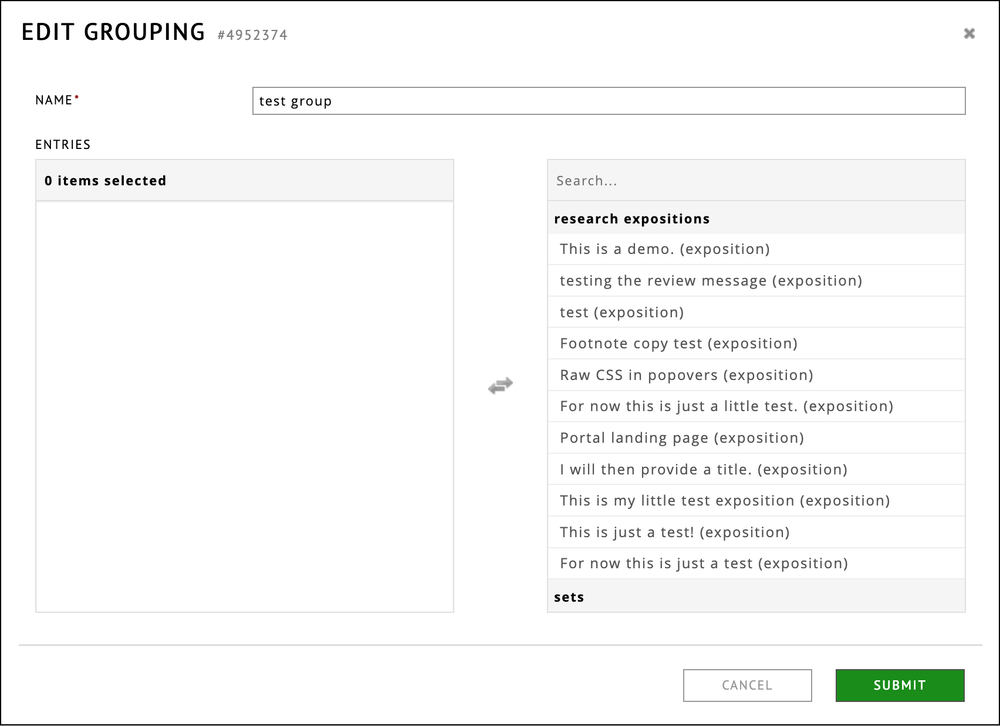
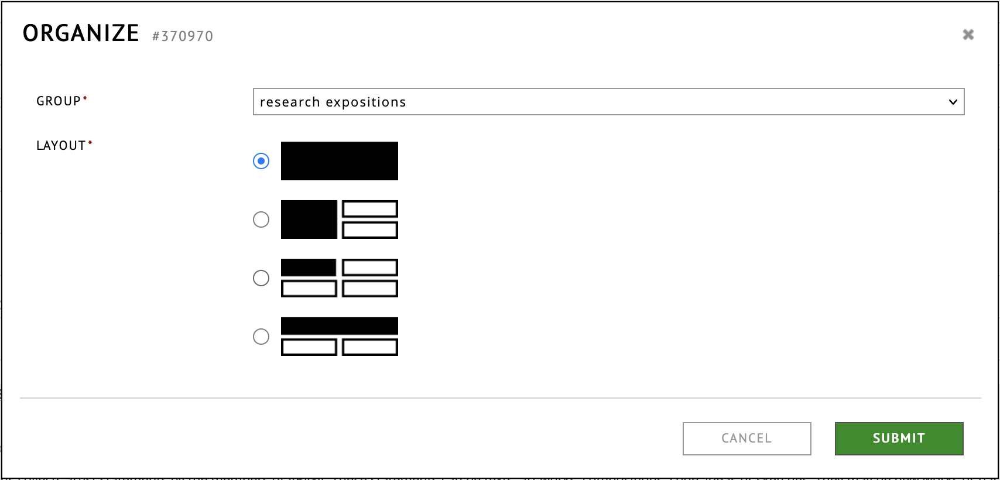

# Profile

## Account menu

Once you have a full account, the following options can be accessed through the
👤 menu on the top right:

* [My Profile](#profile-page)  
  Create and manage expositions, organise your personal profile page.

* [Media Repository](#media-repository)  
  Upload, manage and share media for making expositions later.

* Messages  
  Read direct messages and system notifications.

* [Collaboration](#collaboration)  
  Receive invites from other users and track all [collaborations](#collaboration).

* Feeds  
  [Follow certain topics, people and portals](#follow).

* Settings  
  [Manage your notification settings](#settings).

* Trash  
  If you had deleted an exposition in your profile, you can restore it here (if
  it was deleted less than 30 days ago).

## Your Profile Page {#profile-page}

The RC profile page is both the central hub for your activities on the RC and a
public presentation of your research. It contains two main sections:

1. [Personal info](#personal-info): biographical data, a CV and portal
   memberships.
2. [Expositions](#research-section): a list of your RC objects, such as media
   sets and expositions, arranged in [groupings](#grouping).

Only expositions which are [shared](#share "documentation on sharing") or
[published](#publication "documentation on publication") will be visible to
others. Additionally, you can hide groupings of expositions through
the small dot next to the grouping.

If you are a reviewer, you will also see the headers "Exposition Reviewing" or
"Application Reviewing" on your own profile, containing links to the expositions
you have been assigned to.

### View Public Profile

You can switch between your profile's editing mode (which includes all your
private work in progress) and your public profile, which is the profile as other
users see it. Click on "my profile" for the editing mode and - below your
profile picture - click "view public profile" to see how other people see your
profile.

## Personal Info {#personal-info}

### Description 

You can add a biography or text, that other RC users will see when they visit
your profile. If you want, you can also add a tagline, set your country of
residence, and list your research interests. You can also change the email
address associated with your RC account that will be used to log in and notify
you if you have turned on notifications. Your email address is never shared
publicly. Click "edit profile" to edit all these properties.

### Uploading a CV

In addition to the profile description, it is possible to upload a
more extended CV as a PDF.  To do so, click "upload cv" below your
profile picture.

<!-- ### Degrees -->

<!-- You can also add your __degrees__ to your profile. Enter the
name, the level, the dates and the institution of your degree and link
it via the __relations-tab__ to projects, expositions or works that
you created in support for your degree. -->

### Member of

As a user you can request membership of (some of the) RC
portals. Certain actions can only be done if one is a member of the
portal. For example: for some application programs, it may be required
that you are member of the portal before you are able to submit an
application for a program.

In most cases however, it is the task of the portal admin to make you a member
of their portal. Most portals therefore do not allow users to request membership
themselves.

Click "edit" to request / withdraw a portal membership.

## Expositions {#research-section}

This section of your profile lists all expositions you have created or are
collaborating on. From here you can create new expositions and manage existing
ones through the ☰ menu of each exposition.

### Create Exposition

By clicking "Create exposition" you can create a new exposition object
which will be opened in the RC exposition workspace editor. The
__title__, __copyright__ and __abstract__ fields are required. In
most cases, copyright is assigned to the main author of the exposition. You can
change these details later by choosing ☰ > __edit details__, or in the
__workspace editor__ by clicking the title of your research (at the top of your
screen).

As a beginner you probably want to use Graphical or Block mode, the differences
can be found in the section [choosing an editor](#choosing-an-editor).

### Exposition Menu (☰) {#exposition-details-menu}

To access the menu, click on the "hamburger" menu icon, located in
the bottom right corner of an object (expositions or works). Some
options are only available to the [owner](#the-owner-role) of the object.

__Editing__

* __Edit workspace__ open the exposition in the editor.

* __Edit details__ change the metadata of your exposition, and
  control collaboration with other users. See [edit
  details](#edit-research).

* __Manage versions__ create or restore snapshots, see
  [versions](#manage-versions).

__Profile layout__

* __Organize__ change the grouping and set the box size. See
  [organising your profile](#grouping).

* __Add to shortcut__ add a compact link to this object on the top of
  your profile.

__Visibility and publication__

* __Share__ change the visibility of the exposition: private, public or shared
  to a specific group. Sharing is only available if the exposition is still a
  work in progress. After (self)publication of the research, the share status
  is ignored.

* __Self-publish__ turn an exposition into a fixed object that can be safely
  referenced. This is the only way the RC will register a DOI outside of
  submitting to a journal or portal.  
  *Publishing is a one-way action: once published one can not unpublish.* If
  you want to keep the option of removing an exposition, do not use this
  option.

* __Connect to__ send a connection request to a Portal or Group.
  *Only the [owner](#the-owner-role) can do this.*

__Review__

* __Submit for review__ this will submit the publication for review (and
  possibly publication). Submitting will change the status of the exposition to
  "in review" and will prevent you from editing it further.  
  *Only the [owner](#the-owner-role) can submit for review and only the portal
  admin can undo it.*  
  [See a full visual overview of review workflow here.](https://www.researchcatalogue.net/view/2666692/2666693)

* __Resubmit for review__ this option is shown when the exposition was put "in
  revision" during a review process. Using it will lock the exposition and
  inform the portal admin that the exposition has been resubmitted.  
  *Only the [owner](#the-owner-role) can do this.*

__Other__

* __Export__ allows to export an exposition as either PDF or HTML.

  - __HTML:__  
    A complete offline version of the exposition as a folder of HTML
    compressed to a zipfile. It is equivalent to the online version and can be
    read using any browser, but does not require an internet connection. The
    start page is named __index.html__ .

  - __PDF:__  
    Alternatively you can select PDF format. Dynamic elements as slideshows,
    video and audio recordings cannot be included in this format.

* __Delete__ delete an exposition or work from the RC. Deleted expositions can
  be restored for 30 days via 👤 > __Trash__.  
  *Only the [owner](#the-owner-role) can do this.*

### Edit Details {#edit-research}

This dialog can be opened by __☰ > edit details__ or clicking the
title of the exposition in the workspace editor. It allows you to edit
metadata, collaborations with other users and the table of contents.

The dialog has the following tabs:

* __Meta data__ change the:
  -  __title__ (*)
  -  __date__
  -  __abstract__ (*)
  -  __keywords__ use this to make your exposition easier to find. The RC
     currently uses an open vocabulary, please take care to not needlessly
     duplicate terms, the field will automatically suggest existing terms.
  -  __affiliation__
  -  __external link__
  -  __entry page__ the page the exposition starts at
  -  __author pseudonym__ see [below](#being-anonymous).

  (*) = __title__ and __abstract__ are obligatory.

* __Table of content__ change the content menu, which the user can use
  to navigate between pages. See [table-of-content](#table-of-content).

* __Collaboration__ add co-authors, editors and supervisors. See
  [collaboration](#collaborating-on-research).

* __Relations__ create relationships with other objects on your
  profile, which will result in them being listed on the Research
  page.

### Author Pseudonym and Anonymity {#being-anonymous}

By default an exposition always appears under the name of the user(s) that
have edited it. The __author pseudonym__ field allows you to customize what is
displayed as author, for example if you are publishing an exposition as a group
(ie "The Beatles", "Monty Python") or when representing somebody or something
else. If an __author pseudonym__ is provided, the author pseudonym will replace
the authors names wherever the work is shown on RC (and in the
[DOI](https://www.doi.org) deposit, if the exposition is published).

<strong style="color:red">Important: using a pseudonym does not make you fully
anonymous</strong>, as the authors and co-authors will still be displayed in
the metadata (contributors are not shown).

The only way to be fully anonymous, is to request an ALIAS for your account as
a whole. You can request an ALIAS by contacting:
[support@researchcatalogue.net](mailto:support@researchcatalogue.net). In this
case, your own name will not be shown anywhere in public pages of the RC,
however even with an ALIAS, SAR will still be able to identify the user that
created the exposition if there is copyright infringement or other illegal
material.

### Manage Versions

It is possible to create a snapshot of your exposition, which you can
restore later. 

A snapshot is created by going to ☰ > __versions__ and clicking __add
snapshot__.

When you restore a snapshot, the original is never overwritten, instead a new
exposition, with a new id and urls, will be created from the snapshot. You can
also use this property of snapshots to duplicate or clone an exposition. 

There are three options for how to deal with the
[collaboration](#collaborating-on-research) settings of a restored
snapshot:

* __private__ remove all collaborators (only you can see the restored
  exposition snapshot).
* __restore__ the collaboration will be as it was when the snapshot
  was taken.
* __keep__ the collaboration as it is in the current version of the
  exposition.

One can also restore as private and change the settings afterwards of
course, through the collaboration and share menus.

#### Versions of Published Expositions

Published expositions cannot be changed in the RC (this is per
definition, to allow referencing content within these expositions by
other researchers), but duplicates can.

To get an editable duplicate of a published exposition one has to:

1. make a snapshot of the published exposition.
2. restore the snapshot.

This duplicate can now be edited, without the changes having effect on
the original published exposition.

## Organising Your Profile {#grouping}

### Default Groupings

When you create a set or exposition the new objects will appear in
default groupings ("Sets" and "Expositions"). If you are invited to
one by another RC user, they will appear under "Expositions
(collaborated)".

### Custom Groupings {#custom-grouping}

You can also create your own exposition groupings. To add a new
grouping click "add grouping", which is at the top of your profile. 

* __Sorting__ drag an exposition to change its position within a grouping, or
  drag a grouping itself to change the order of the groups.

* __Editing__ on the right-hand side of a grouping's title, there are a series
  of icons displayed .
  Here you can edit and delete the grouping and control its public visibility
  (using the eye icon). You can also edit which expositions are part of the
  group.

* __Per exposition__ you can also set the grouping directly per exposition.
  For this, you use ☰ > Organize, and select the appropriate group from the
  dropdown.

Only custom groupings can be deleted. If you have only one grouping
containing content, its title will not be shown on your public
profile. Empty groupings will also not be displayed on your public
profile page.

### Tips for Cleaning Up Cluttered Profiles {#tips-cleaning-up-cluttered-profiles}

* __Delete__ expositions you have created by clicking ☰ > delete exposition.
  Expositions which are in review or published cannot be deleted.
* __Leave collaboration__ if you are co-author, contributor or supervisor of an
  exposition, to remove the exposition from your profile.
* __Collapse groupings__ by clicking the small triangle on the left of the
  grouping.
* __Shrink or regroup__ an exposition by clicking ☰ > organize.
* __Zoom out__ in your browser (ctrl/cmd + and ctrl/cmd -) to get an overview.
  You can return to the default zoom level with ctrl/cmd 0.

## Legacy

### Add Work

Works are an older feature, which has now been replaced by media sets
through the [media repository](#media-repository).  If you had created
works previously, you can still edit or remove them.

### Add Project 

Projects were part of an external import of data, they are no longer
available for users.
